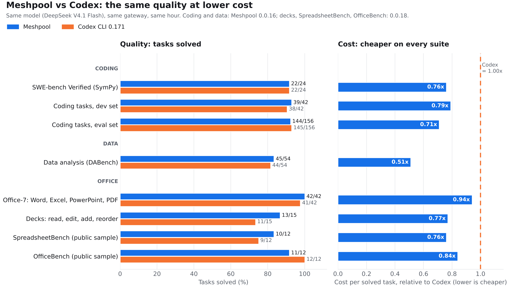

<p align="center">
  <picture>
    <source media="(prefers-color-scheme: dark)" srcset="app/meshpool_harness/ui/brand/logo-dark.png">
    
  </picture>
</p>

<p align="center"><strong>One desktop agent for code, documents, spreadsheets, decks and research, on any model.</strong></p>

<p align="center">
  <a href="https://github.com/hamzaziada4422/meshpool-harness/releases"></a>
  
  
</p>

Meshpool runs on your own computer. It does research, writing, analysis, spreadsheets, decks and code with any model on the Meshpool endpoint, your own OpenAI-compatible key, or the ChatGPT plan you already pay for.

> [!NOTE]
> **Meshpool is a beta (currently 0.0.20).** Some things will break. When one does, Meshpool shows what went wrong in the chat, and **Report this** (or the **Beta** badge) opens a GitHub issue with your version and system filled in. Your chats and files are never included.

## What Meshpool does

1. **Writes and fixes code in your project.** It reads the code, makes the change, runs the tests and shows every edit as a diff you can undo, like Codex or Claude Code.
2. **Does real office work.** It reads, edits and creates Word documents, Excel workbooks with live formulas, PowerPoint decks and PDFs. It edits your existing files in place and checks every file before you get it.
3. **Analyses data and researches the web.** It turns CSV and Excel files into answers and charts, and researches a question across the web with sources.
4. **Runs any agent on any model, on your computer.** Meshpool's own agents, Codex, Pi and others in one app, on the Meshpool endpoint, your own OpenAI-compatible key or your ChatGPT plan. Your files stay on your computer, and it asks before anything risky, such as deleting files or using the internet.

<p align="center">
  <picture>
    <source media="(prefers-color-scheme: dark)" srcset="docs/screenshots/home-dark.png">
    
  </picture>
</p>

| You stay in control | Pick the agent, or let Auto pick |
|---|---|
|  |  |
| Every change shows up as a diff. meshpool asks before risky steps, such as deleting files or using the internet, and does ordinary work in your folder on its own. Undo reverses any reply. | Each agent says what it does best. Meshpool Auto picks per task from the benchmarks. |

## How it compares with Codex

Meshpool solves as many tasks as Codex and costs less per solved task on every suite: **326 vs 322 of 357 tasks solved, at 0.51x to 0.94x of Codex's cost**.

<p align="center">
  <picture>
    <source media="(prefers-color-scheme: dark)" srcset="docs/benchmarks/headline-dark.png">
    
  </picture>
</p>

| Area | Suite | Solved, Meshpool vs Codex | Cost per solved task vs Codex | Time vs Codex |
|---|---|---|---|---|
| Coding | SWE-bench Verified (SymPy) | 22 vs 22 of 24 | **0.76x** | 0.93x |
| Coding | Coding tasks, dev set | 39 vs 38 of 42 | **0.79x** | 0.99x |
| Coding | Coding tasks, eval set | 144 vs 145 of 156 | **0.71x** | 1.03x |
| Data | Data analysis (DABench) | 45 vs 44 of 54 | **0.51x** | 0.81x |
| Office | Office-7: Word, Excel, PowerPoint, PDF | 42 vs 41 of 42 | **0.94x** | 0.76x |
| Office | Decks: read, edit, add, reorder | 13 vs 11 of 15 | **0.77x** | 1.31x |
| Office | SpreadsheetBench (public sample) | 10 vs 9 of 12 | **0.76x** | 0.98x |
| Office | OfficeBench (public sample) | 11 vs 12 of 12 | **0.84x** | 1.20x |

How this was measured:
- **Same conditions.** Meshpool and Codex CLI 0.171 ran on the same model (DeepSeek V4.1 Flash), through the same gateway, in the same hour, with the same tasks and graders.
- **Cost and time.** Cost is billed cost per solved task as a multiple of Codex's; under 1.00x is cheaper. Time is the median of per-task time ratios; under 1.00x is faster.
- **Versions.** Coding, data and Office-7 were measured on Meshpool 0.0.16; decks, SpreadsheetBench and OfficeBench on 0.0.18.
- **Where Codex is ahead.** Codex solved one more OfficeBench task (12 vs 11) and one more eval-set coding task (145 vs 144), and was faster on decks (meshpool took 1.31x its time), OfficeBench (1.20x) and the eval set (1.03x). The office samples are small, so a single task moves them.
- **Raw data.** Every run is in [docs/results](docs/results), and [docs/BENCHMARKS.md](docs/BENCHMARKS.md) has the full history.

## Install

| Computer | Download |
|---|---|
| Mac with Apple silicon | [Meshpool.dmg](https://github.com/hamzaziada4422/meshpool-harness/releases/latest/download/Meshpool.dmg) |
| Mac with Intel | [Meshpool-Intel.dmg](https://github.com/hamzaziada4422/meshpool-harness/releases/latest/download/Meshpool-Intel.dmg) |
| Windows 10 or 11 | [Meshpool-Setup.exe](https://github.com/hamzaziada4422/meshpool-harness/releases/latest/download/Meshpool-Setup.exe) |
| Linux, 64-bit Intel or AMD | [Meshpool-Linux-x64.tar.gz](https://github.com/hamzaziada4422/meshpool-harness/releases/latest/download/Meshpool-Linux-x64.tar.gz) (see [SETUP.md](docs/SETUP.md)) |

**Setup guide** ([full guide](https://github.com/hamzaziada4422/meshpool-harness/blob/main/docs/SETUP.md))

*Mac, quickest:* open Terminal, paste this and press Return. It installs Meshpool and opens it with no security prompts:

```sh
curl -fsSL https://raw.githubusercontent.com/hamzaziada4422/meshpool-harness/main/install.sh | bash -s -- --app
```

*Mac, from the download:*
1. Not sure which Mac you have? Apple menu → About This Mac: **Chip: Apple M…** takes Meshpool.dmg, **Intel** takes Meshpool-Intel.dmg.
2. Open the .dmg and drag **Meshpool** onto **Applications**.
   

3. Double-click Meshpool in Applications. macOS blocks it the first time: click **Done**.
   

4. Open **System Settings → Privacy & Security**, scroll to **Security**, click **Open Anyway** and enter your password. Meshpool opens, and opens normally from then on. (macOS 14 and earlier: right-click Meshpool in Applications, choose **Open**, then **Open**.)
   


*Windows:* run Meshpool-Setup.exe. If "Windows protected your PC" appears, click **More info**, then **Run anyway**.

 


*First launch:* paste your Meshpool API key ([get one at meshpool.ai](https://meshpool.ai)) or sign in with ChatGPT, then choose the folder Meshpool may work in. Updates: click the "is available" bar, or Settings → About → **Check for updates**, then **Update now**.

Macs, Apple silicon and Intel, need macOS 11 or later (browser use needs macOS 13). Meshpool is not yet signed by Apple or Microsoft, which is why your computer asks you to confirm it once. The pictures of the macOS and Windows prompts are illustrations; the wording on your computer may differ slightly.


**Command line** (macOS, Linux, Windows). One command installs it and runs setup; then type `meshpool` in any project folder, or `meshpool ui` for the full app in your browser. The terminal install does not include LibreOffice, so decks are not rendered for review and workbook formulas are not recalculated; the desktop app has both.

```sh
curl -fsSL https://raw.githubusercontent.com/hamzaziada4422/meshpool-harness/main/install.sh | sh
```

```powershell
irm https://raw.githubusercontent.com/hamzaziada4422/meshpool-harness/main/install.ps1 | iex
```

## What it does

- **Work and Code modes.** Work is a chat with a live progress panel and the files the task made. Code adds diff, terminal, Git, pull request and CI panels.
- **Agents:** Meshpool Auto, Meshpool Code, Meshpool Work, Pi, Hermes, Codex and OpenCode, or your own, on your Meshpool key, any OpenAI-compatible key, or your ChatGPT plan ([providers](docs/PROVIDERS.md)).
- **Files in and out:** PDF, Word, Excel, PowerPoint, Power BI (the model schema; the data model needs `pip install pbixray`), CSV and images in; Word, Excel, PowerPoint and PDF out. Reading text in scanned PDFs and pictures (OCR) is optional and not included: run `pip install rapidocr onnxruntime` (macOS 13 or later, Windows, Linux) in the Python Meshpool uses; without it you get the file's own text only.
- **Web research** across many sources, with links you can check, and **browser use** that works out of the box (it opens pages, reads the elements, clicks and types; Playwright and Chromium set themselves up on first use).
- **58 connectors** (GitHub, Linear, Jira, Slack, Notion, Google Drive, HubSpot, Stripe and more) plus any remote MCP server. Sign-in goes straight from your computer to the app.
- **About 100 skills**, and the skills, MCP servers, memories and instructions you already have in Claude Code, Codex, Cursor, OpenClaw, Hermes and others, imported in a click with a preview (`meshpool import agents --dry-run`). Logins are never read.
- **Memory you can see.** One page lists everything Meshpool knows, where each fact came from and where it was used. Edit or remove any of it; incognito chats keep nothing.
- **Quiet suggestions.** At most one short nudge at a time, only when a chat ends or you open the app, and always with what Meshpool saw. Switch it off in Settings.
- **Receipts.** Time, cost where known, the agent chosen and the checks that ran, under each reply.
- **Scheduled tasks and parallel sub-agents.**
- **Isolated copies:** a Code chat, a terminal session (`meshpool -w`), sub-agents that edit at the same time and each scheduled run on a git folder can work in a copy of their own (a git worktree, or a plain copy without git), so they never edit your working copy. You review the diff, then merge or discard ([worktrees](docs/setup/worktrees.md)).
- **meshpool in Excel, PowerPoint and Word** (new, not yet checked in real Office): a panel on the Home tab that answers about your selection and inserts the answer ([setup](docs/setup/office-add-in.md)).
- **You stay in control:** Enter adds to the task, Interrupt redirects it, Esc stops, and Undo reverses any reply. Settings, Permissions sets when meshpool asks you: only for risky actions (the default), before every command and change, or never.
- **For scripts and your own setup:** one-shot runs with JSON output ([terminal](docs/setup/terminal.md)), [hooks](docs/setup/hooks.md), [skills](docs/setup/skills.md) and [sub-agents](docs/setup/sub-agents.md).

## For developers

```sh
cd app
pip install -r requirements.txt
python -m meshpool_harness ui
```

`app/` holds the agent, the desktop UI, the office engines and the tests; `packaging/` the installers and launchers; `testkit/` the mock model and end-to-end checks; `docs/` [benchmarks](docs/BENCHMARKS.md), [routing](docs/ROUTING.md), [building](docs/BUILDING.md) and [releasing](docs/RELEASING.md).

## Credits

Meshpool bundles third-party open-source software, each under its own license: see [THIRD_PARTY_NOTICES.md](THIRD_PARTY_NOTICES.md). The Meshpool name and logo belong to Meshpool.
